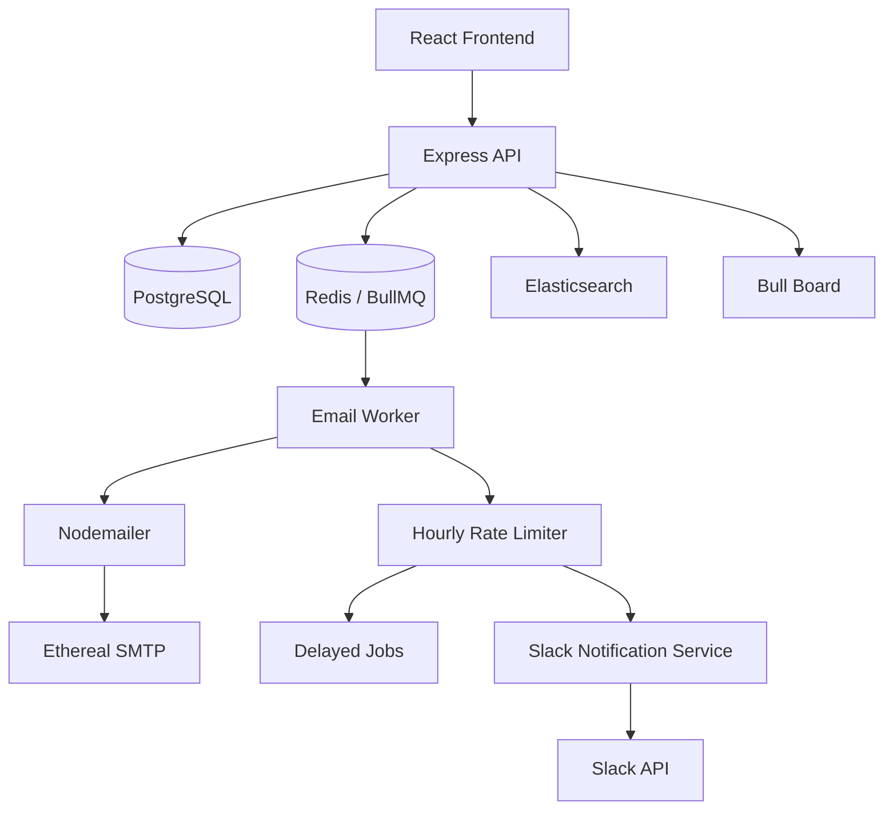

# Outbox Scheduler

A reliable email scheduling and delivery platform built to manage scheduled campaigns, process emails asynchronously, enforce sending limits, and notify users when campaigns are throttled.

## Overview

Outbox Scheduler allows users to compose and schedule email campaigns through a web interface. Instead of sending emails directly from an API request, the application uses background workers and a queue-based architecture to process deliveries independently.

The system also implements hourly sending limits, delayed job processing, email history, and Slack notifications when a campaign reaches its sending limit.

## Key Features

- **Email Scheduling:** Compose emails and schedule delivery for a future date and time.
- **Campaign Management:** Schedule multiple recipients under a single campaign.
- **Background Processing:** Use BullMQ and Redis to process email jobs asynchronously.
- **Hourly Sending Limits:** Enforce campaign-level hourly sending limits.
- **Automatic Deferral:** Move jobs to a delayed state when the sending limit is reached.
- **Slack Notifications:** Notify users through Slack when a campaign reaches its hourly sending limit.
- **Scheduled Emails:** View and cancel upcoming email deliveries.
- **Sent Email History:** View successfully processed emails.
- **Email Preview:** Use Ethereal Email to test SMTP delivery and inspect sent messages.
- **Search:** Elasticsearch integration for indexing and searching email records.
- **Queue Monitoring:** Bull Board dashboard for monitoring background job queues.

## Tech Stack

| Layer | Technologies |
|---|---|
| Frontend | React, Vite |
| Backend | Node.js, Express.js, TypeScript |
| Database | PostgreSQL |
| Queue Management | BullMQ |
| Queue Storage | Redis |
| Email Delivery | Nodemailer, Ethereal Email |
| Search and Indexing | Elasticsearch |
| Notifications | Slack API, OAuth 2.0 |
| Queue Monitoring | Bull Board |

## System Architecture



### Email Processing Workflow

1. A user composes an email campaign and selects recipients and a scheduled delivery time.
2. The backend validates the request and stores campaign and email records in PostgreSQL.
3. Email jobs are added to a BullMQ queue backed by Redis.
4. A separate worker retrieves and processes queued jobs.
5. Nodemailer handles email delivery through the configured SMTP provider.
6. The hourly rate limiter checks whether the campaign has reached its sending limit.
7. If the limit is reached, the remaining email job is deferred for the configured interval.
8. The Slack notification service sends a notification to the connected Slack user.
9. Email statuses are updated and records are indexed in Elasticsearch.

## Project Structure

```text
OutBox_Scheduler/
│
├── backend/
│   ├── src/
│   │   ├── config/
│   │   ├── controllers/
│   │   ├── middleware/
│   │   ├── models/
│   │   ├── queues/
│   │   ├── routes/
│   │   ├── services/
│   │   ├── workers/
│   │   ├── utils/
│   │   └── server.ts
│   ├── package.json
│   └── tsconfig.json
│
├── frontend/
│   ├── src/
│   └── package.json
│
├── .gitignore
└── README.md
```

*The directory structure above represents the main application organization. Adjust individual filenames if your final repository differs.*

## Prerequisites

Install the following before running the application:

- Node.js and npm
- PostgreSQL
- Redis
- Elasticsearch
- A Slack application for OAuth integration

## Installation and Setup

### 1. Clone the repository

```bash
git clone https://github.com/YOUR_USERNAME/outbox-scheduler.git
cd outbox-scheduler
```

### 2. Backend setup

```bash
cd backend
npm install
```

Create a `.env` file in the backend directory and configure the required environment variables.

Core configuration includes:

```env
PORT=5000
DATABASE_URL=your_postgresql_connection_string

REDIS_HOST=localhost
REDIS_PORT=6379
REDIS_PASSWORD=

SMTP_HOST=your_smtp_host
SMTP_PORT=your_smtp_port
SMTP_USER=your_smtp_username
SMTP_PASS=your_smtp_password
```

Configure the remaining Elasticsearch and Slack OAuth settings according to your backend configuration. Never commit actual credentials.

### 3. Start the backend

```bash
npm run dev
```

### 4. Start the email worker

Open a separate terminal:

```bash
cd backend
npm run worker
```

The worker runs independently from the API server and processes queued email jobs.

### 5. Start the frontend

Open another terminal:

```bash
cd frontend
npm install
npm run dev
```

Use the local URL displayed by Vite to access the application.

### 6. Build the backend

```bash
cd backend
npm run build
```

## Queue Monitoring

Bull Board provides a dashboard for monitoring background jobs and queue activity.

Once the backend is running, access:

```text
http://localhost:5000/admin/queues
```

## Email Testing

The project uses Ethereal Email for test email delivery.

Ethereal provides temporary SMTP accounts and email preview links, allowing developers to inspect test messages without sending emails to real recipients.

## Slack Integration

Outbox Scheduler integrates with Slack using OAuth 2.0.

After connecting a Slack workspace, the application can send direct-message notifications when a campaign reaches its hourly sending limit.

Example notification:

> Outbox Scheduler: Hourly sending limit reached.  
> Campaign: [Campaign Name]  
> Sending will resume after approximately 60 minutes.

## Rate Limiting Demonstration

A test campaign with two recipients and an hourly sending limit of one demonstrates the rate-limiting mechanism.

Expected behaviour:

1. The first email is processed and sent.
2. The second email detects that the hourly limit has been reached.
3. BullMQ moves the second job to a delayed state.
4. The worker logs the deferral.
5. A Slack notification informs the user about the limit.
6. The deferred email becomes eligible for processing after the delay.

## Future Improvements

- Support multiple SMTP sender accounts with configurable sending limits.
- Add retry policies and more comprehensive failure handling.
- Improve campaign analytics and delivery reporting.
- Add configurable notification preferences.
- Introduce more advanced queue monitoring and operational metrics.

## Author

**Bushra Mahek Maniyar**

Computer Science and Engineering

GitHub: [Bushra-Mahek](https://github.com/Bushra-Mahek)

---

**Outbox Scheduler — Reliable, asynchronous, and controlled email delivery.**